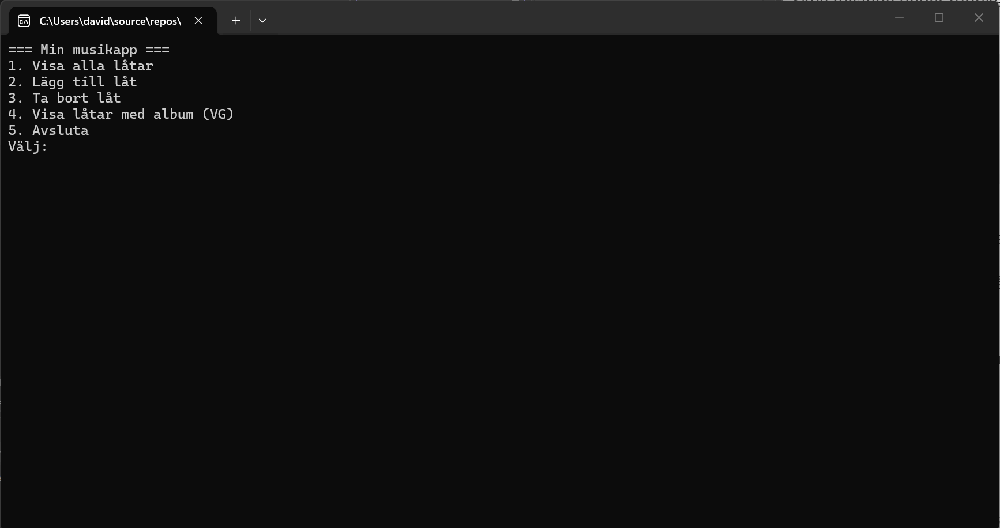

# Musiklistappen — [Ditt namn]

> **Instruktion till dig:** den här filen är *din* README. Ersätt all text i hakparenteser med din egen, och ta bort den här rutan när du är klar. Uppgiften och kraven står i [`UPPGIFT.md`](UPPGIFT.md), och inlämningen beskrivs i [`INLAMNING.md`](INLAMNING.md).

---

## Vad appen gör

Jag har byggt en musikapp i C# som använder en SQLite-databas med låtar från Katy Perry. I huvudmenyn kan man visa alla låtar, lägga till nya låtar och ta bort låtar genom deras ID. Jag har även gjort en VG-funktion som visar låtar tillsammans med albumets namn.

## Så kör du den

```bash
git clone https://github.com/DavidSundkvist/clo26-musiklistappen.git
cd clo26-musiklistappen/MusikApp
dotnet run
```
För att köra programmet behöver man ha .NET SDK. Databasfilen musik.db behöver finnas i mappen MusikApp/, och anslutningen till databasen finns i appsettings.json.

## Så ser huvudmenyn ut



---

## Mina designval (VG)

*Fyll i det här avsnittet om du siktar på VG. Annars kan du ta bort det.*

1. **Hur designade du din databas? Varför valde du just den strukturen?**
Jag använde min SQLite-databas från den tidigare diskografiuppgiften om Katy Perry. Den består av tabellerna artists, albums, songs, genres och song_genres.

Jag delade upp informationen i olika tabeller för att undvika att samma information upprepas flera gånger. Jag använde primary keys för unika ID och foreign keys för att skapa relationer mellan tabellerna. Till exempel använder songs ett album_id för att koppla en låt till rätt album.
 

2. **Vilket SQL-krav valde du (JOIN eller subquery) och varför passade det din app?**
Jag valde att använda INNER JOIN för att visa låtens titel tillsammans med albumets namn.

Eftersom låtar och album ligger i olika tabeller behöver de kopplas ihop. Jag gjorde detta genom songs.album_id = albums.id.

Det passade min app eftersom användaren då kan se vilket album varje låt tillhör.

3. **Vad skulle du gjort annorlunda om du byggde om den från scratch?**
Om jag skulle göra om projektet hade jag planerat kodens struktur bättre från början och kontrollerat databasanslutningen tidigare.
jag ska använde va transparant med assistans av AI då jag behövde hjälp med struktur och vad som kunde göras bättre med min kod samt hjälpa mig när det blev errors eller att koden inte synkade med varandra.

Ett problem jag hade var att programmet inte hittade rätt databas eftersom filen låg fel och vid ett tillfälle hade fel filändelse. Jag fick därför ändra sökvägen och kontrollera att programmet använde rätt musik.db.

Jag fick också ändra min DeleteSong()-metod eftersom det inte gick att ta bort vissa låtar direkt. Det berodde på att låtarna hade kopplingar till tabellen song_genres genom foreign keys. Jag löste det genom att först ta bort kopplingarna och sedan själva låten. Jag använde även en transaktion så att båda ändringarna hör ihop.

När jag gjorde min VG-funktion råkade jag också lägga GetSongsWithAlbum() på fel plats och fick två metoder med samma namn. Jag behövde därför flytta metoden till rätt del av DbHandler.cs.

Jag skulle även förbättra felhanteringen med TryParse() istället för Parse() och göra det enklare att välja album när man lägger till en låt.

Det jag framför allt har lärt mig är att det är viktigt att ha en tydlig struktur, förstå relationerna i databasen och testa varje funktion innan man går vidare.
